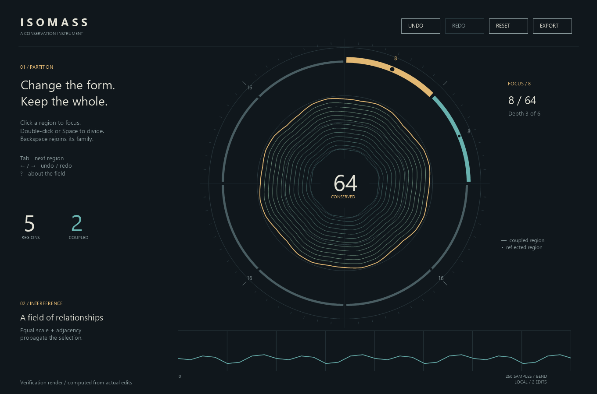

# Isomass

A Windows instrument for exploring how a whole can change shape while its
total capacity stays 64. Divide regions, follow their coupling relationships,
and watch the resulting interference form.

**[Download Isomass for Windows](https://github.com/wolfbreed1829/isomass-download/releases/latest/download/Isomass-windows-x64.zip)**

[Release notes and checksums](https://github.com/wolfbreed1829/isomass-download/releases/latest)

## Requirements

- Windows x64.
- WSL2 with an Ubuntu distribution named `Ubuntu` (tested on Ubuntu 24.04).
- Ubuntu's `libgmp.so.10` and standard GNU/Linux runtime libraries.

The Java runtime is included. Isomass runs locally as a desktop app; this
page provides the download, not a browser version.

## Open the app

1. Download and extract the ZIP into a writable local folder.
2. Open `Isomass.exe` inside the extracted `Isomass` folder.
3. Keep its `bin`, `runtime`, and `src` folders beside the executable.

## Explore

Click an arc to focus it. **Space** or a double-click divides it.
**Backspace** rejoins its sibling family. **Left / Right** undo and redo;
**Tab** selects the next region. **Reset** returns to a whole and remains
undoable. **Export** saves the actual rendered image as a PNG.

The current structure saves automatically in `data/session.txt`.
Press **?** or **F1** for the field explanation.

## About this release

Idris 2 enforces the indexed partition and proves its mass theorem. Flix
derives relational coupling and reflection. Bend computes 256 field samples
through HVM. A native Win32/GDI+ bridge handles drawing and input.

This is a mathematical instrument, not a physical simulation. The proof
covers the partition mass, not the whole operating system or application.
The package includes documentation and upstream runtime license notices.

The development repository is private. This repository provides the desktop
download, preview and usage information.
